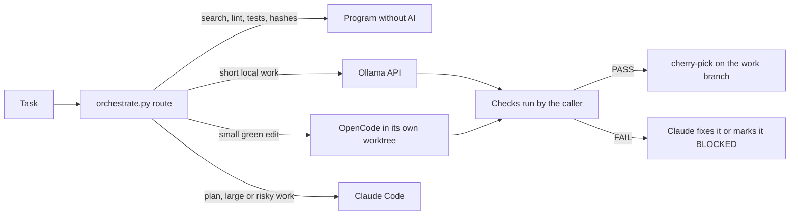

# 005. Verification and orchestration

An agent's report of its own work is not evidence. Evidence is an exit code, a diff, a test result or a checksum that a separate program produced. Everything in this chapter follows from that rule.

## The flow



1. Detection. At startup the `session_probe` hook says whether OpenCode is installed, whether Ollama answers, how many free models the owner checked and the privacy class of the folder. It installs nothing, contacts nothing remote and never blocks the session. Detection alone delegates nothing.
2. Decision. `orchestrate.py route` applies `settings/orchestration.yml`: the task type, the traffic light, the number of files, the privacy class and the measured history. A program without AI comes first whenever it can do the job. Yellow and red items stay with Claude. The answer can be "blocked".
3. Delegation. `orchestrate.py delegate opencode` creates a worktree on a new `delegate/<id>` branch from HEAD, writes a short task file (purpose, allowed files, protected files, the test command, base commit, untrusted material fenced as data), runs OpenCode with an explicit model, and keeps the exit code and the output. Credentials are removed from its environment. `delegate ollama` calls the API directly with thinking off, a fixed context and a token limit.
4. Verification. The caller, not the executor, checks that something changed, that nothing outside the allowed files and nothing protected changed, and that the tests pass. Only then it commits on the delegate branch. Every state change (planned, approved, running, blocked, failed, verified, integrated) is written to `~/.standards/runs/<id>.json`, so a session that stops can see what was done instead of doing it twice.
5. Integration. Claude cherry-picks a verified commit and runs the check again. Two writers never share a worktree.

## Privacy

| Class | Ollama | Free remote models | Claude |
| --- | --- | --- | --- |
| personal-public | yes | yes | yes |
| personal-private | yes | only with the owner's consent for that folder | yes |
| work | yes | never | only with the owner's consent |
| restricted | yes | never | never |

The class comes from `~/.standards/local.yml`, which only the owner edits (`orchestrate.py consent`, and the guard hook asks before an agent runs it). A repository can declare a stricter class in `.standard.yml` with `privacy:`, never a looser one. A model whose name ends in `free` is not trusted to be free: it counts only when the owner checked it within the last 30 days, and the router never moves to a paid model on its own.

## Verification

`verify.py` runs what applies and writes `report.json` (validated against `schemas/verify-report.schema.json`) and `report.md` inside the git folder. Statuses are PASS, FAIL, SKIP (does not apply, with the reason), ERROR (the check broke) and NOT_RUN (a required check could not run). The verdict is PASS only when every required check passed or was skipped with a reason.

`adversarial.py` attacks the controls on purpose with fake executors in real worktrees: an executor that obeys injected text, one that edits tests, one that edits outside its files, one that claims success without a change, one that hangs, one that reads credentials, an Ollama that replies with broken JSON or is down, client code sent to a free model, broken patches, lost data. Each scenario passes only when the control stopped it.

`preserve.py` protects data with checksums, id lists and minimum counts, and lists what an extraction still misses so it can resume. `safe_patch.py` proves a patch applies on its base and passes the tests there. `memory.py` keeps decisions and test results in SQLite FTS5, labels agent entries as hints and refuses secrets.

## One run for everything

```
python scripts/verify.py --level deep --live
```

`scripts/verify-all.ps1` does the same in Windows PowerShell and adds the PowerShell folder to the PATH of that window only. Without `--live` nothing outside the machine is touched. With it, the run also asks the local Ollama, runs one bench task per free model the owner checked, and lists the tools of each MCP server in trial.

## Known limits

- The guard hook matches text, so a command written in an unusual way can pass it. The worktree, OpenCode's own permissions and the checks after each run are the other layers.
- Bench results belong to one machine and one day. The router uses them only after three runs with a pass rate of at least 0.8.
- Prompt-injection resistance of a model is reported, never relied on. The controls are the protected files, the scope check and the tests.
- MCP servers are off by default. `mcp inspect` lists what a server exposes. It does not prove the server is safe.
