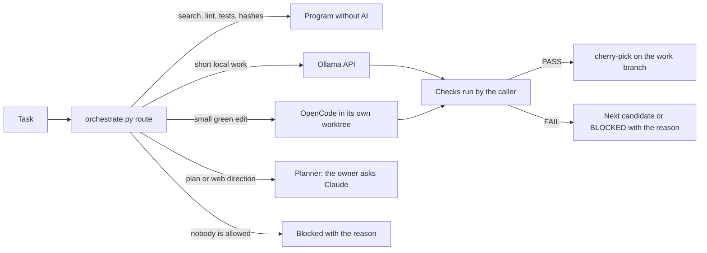

# 005. Verification and orchestration

An agent's report of its own work is not evidence. Evidence is an exit code, a diff, a test result or a checksum that a separate program produced. Everything in this chapter follows from that rule.

## The flow



1. Detection. At startup the `session_probe` hook says whether OpenCode is installed, whether Ollama answers, how many free models the owner checked and the privacy class of the folder. It installs nothing, contacts nothing remote and never blocks the session. Detection alone delegates nothing.
2. Decision. `orchestrate.py route` applies `settings/orchestration.yml` in this order: can a program without AI do it, does the cost mode allow the executor, does the privacy class allow it, can the model do what the task needs, did it pass the bench class when the task or the risk asks for proof, and only then which allowed candidate is fastest. Cost, privacy and risk are never added into one score. Yellow and red items need the owner's review, whoever does the work. A model in cooldown after a failure is skipped and the next candidate is offered, except for Colibri, which has no fallback. A local model comes from the task type's own list in `executors.ollama.prefer_by_task`, or from `executors.ollama.prefer` when it has none, and a model that failed the bench class of the task is passed over with the reason. A request that names its executor, such as "con Colibri", uses that executor or is blocked with the reason and the bench evidence of the model it serves. Bench evidence expires after `limits.bench_recheck_days`, and `orchestrate.py models` prints what is discovered, tested and authorized with the date the evidence expires. A task type that is not listed is blocked, and `plan` and `web-direction` answer `planner`. The answer can be "blocked". `006-model-analyzer.md` explains the cost modes.
3. Delegation. `orchestrate.py delegate opencode` creates a worktree on a new `delegate/<id>` branch from HEAD, writes a short task file (purpose, allowed files, protected files, the test command, base commit, untrusted material fenced as data), runs OpenCode with an explicit model, and keeps the exit code and the output. Credentials are removed from its environment. `delegate ollama` calls the API directly with thinking off, a fixed context and a token limit.
4. Verification. The caller, not the executor, checks that something changed, that nothing outside the allowed files and nothing protected changed, and that the tests pass. Only then it commits on the delegate branch. Every state change (planned, approved, running, blocked, failed, verified, integrated) is written to `~/.standards/runs/<id>.json`, so a session that stops can see what was done instead of doing it twice.
5. Integration. A verified commit is cherry-picked and the check runs again, by hand or by `scripts/execute.py`, which does it for every unit of a work plan on the branch `execute/<plan_id>` (see `007-autonomous-execution.md`). Two writers never share a worktree.

## Privacy

| Class | Ollama | Free remote models | Claude |
| --- | --- | --- | --- |
| personal-public | yes | yes | yes |
| personal-private | yes | only with the owner's consent for that folder | yes |
| work | yes | never | only with the owner's consent |
| restricted | yes | never | never |

The class comes from `~/.standards/local.yml`, which only the owner edits (`orchestrate.py consent`, and the guard hook asks before an agent runs it). A repository can declare a stricter class in `.standard.yml` with `privacy:`, never a looser one. A model whose name ends in `free` is not trusted to be free: it counts only when the owner checked it within the last 30 days, the catalog does not list it as paid or unknown, and its data use fits the folder. The router never moves to a paid model on its own. Route, delegate, bench and the analyzer all pass through the same gate.

## Verification

`verify.py` runs what applies and writes `report.json` (validated against `schemas/verify-report.schema.json`) and `report.md` inside the git folder. Statuses are PASS, FAIL, SKIP (does not apply, with the reason), ERROR (the check broke) and NOT_RUN (a required check could not run). The verdict is PASS only when every required check passed or was skipped with a reason.

`adversarial.py` attacks the controls on purpose with fake executors in real worktrees: an executor that obeys injected text, one that edits tests, one that edits outside its files, one that claims success without a change, one that hangs, one that reads credentials, an Ollama that replies with broken JSON or is down, client code sent to a free model, broken patches, lost data. Each scenario passes only when the control stopped it.

`preserve.py` protects data with checksums, id lists and minimum counts, and lists what an extraction still misses so it can resume. `safe_patch.py` proves a patch applies on its base and passes the tests there. `memory.py` keeps decisions and test results in SQLite FTS5, labels agent entries as hints and refuses secrets.

## Recall by words and by meaning

`recall.py` gives a new session the decisions and notes that fit its request. Words alone miss a question asked in other words, such as "¿por qué tardó tanto en corregir el error?" for a note that says prefill and timeout. Meaning search adds to the word search, it never replaces it:

```
python scripts/memory.py index --repo .
python scripts/memory.py find "¿por qué tardó tanto en corregir el error?" --repo .
python scripts/memory.py eval my-questions.yml --repo .
```

`index` asks the embedding model of the local Ollama (`memory.model`, `qwen3-embedding:0.6b`) for vectors of the entries and decision records that are new or changed. Each vector records its repository, key, source, content hash, model, model revision and dimensions. An address off this machine is refused, because notes can be private. A vector of another model, revision or size is ignored until `index` rebuilds it, and only those vectors are rebuilt. Each batch is committed, so an interrupted run keeps what it finished. Without Ollama or without vectors, the word search answers alone.

`find` and `recall.py` filter to the repository first, then rank by words (FTS5) and by meaning, and fuse both lists by key with reciprocal rank (`memory.rrf_k`). A meaning match counts only above `memory.min_similarity`. Each result keeps its key, its reference and its source, so an agent hint stays a hint. The prompt hook passes at most a budget of characters.

`eval` measures before anything is trusted. The owner writes real questions in Spanish and English and marks the right fragment before the test, with an exact id, a paraphrase, a question with no answer and two projects with similar words:

```yaml
queries:
  - {query: "Colibri prefill timeout", lang: en, type: exact, expect: [docs/007-autonomous-execution.md]}
  - {query: "¿por qué tardó tanto en corregir el error?", lang: es, type: paraphrase, expect: [entry:42]}
  - {query: "¿qué receta de pan usamos?", lang: es, type: unanswerable, expect: []}
```

It prints, for words alone and for words and meaning, the hits among the first 3 and the first 10 per language and kind as a numerator and a denominator, how many were found only after the third place and how many questions without an answer got none. `min_similarity` 0.5 is a starting value, not a measurement: tune it with `eval`. A reranker such as Qwen3-Reranker-0.6B or BGE-reranker-v2-m3 is worth a test only when the right answer is often in the first 10 and rarely in the first 3. sqlite-vec is worth it only when the number of vectors or the search time asks for an index. Memorilla's latent memory was published for one Qwen3-8B on 80 GB H100 cards, so it stays future research.

Bench runs of a coding agent record the size of the task packet in `input_chars`, so a smaller context can be compared with the `fix-bug` result it gave.

## One run for everything

```
python scripts/verify.py --level deep --live
```

`scripts/verify-all.ps1` does the same in Windows PowerShell and adds the PowerShell folder to the PATH of that window only. Without `--live` nothing outside the machine is touched. With it, the run also asks the local Ollama, runs one bench task per free model the owner checked, and lists the tools of each MCP server in trial.

## Known limits

- The guard hook matches text, so a command written in an unusual way can pass it. The worktree, OpenCode's own permissions and the checks after each run are the other layers.
- Bench results belong to one machine and one day. The router uses them only after three runs with a pass rate of at least 0.8, and only while they are fresh.
- Colibri prefills about 6 tokens per second on the RTX 2060, so it answers short prompts and is not a coding agent on this machine.
- Prompt-injection resistance of a model is reported, never relied on. The controls are the protected files, the scope check and the tests.
- MCP servers are off by default. `mcp inspect` lists what a server exposes. It does not prove the server is safe.
