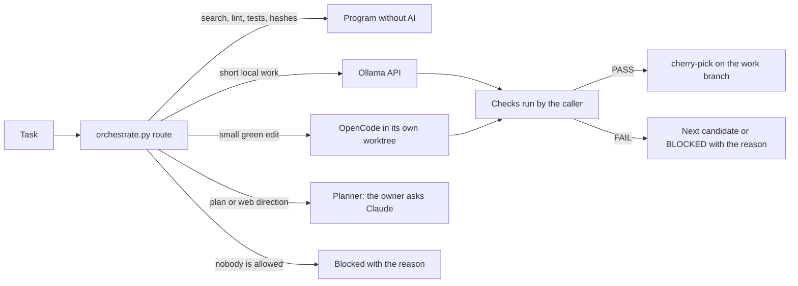

# 005. Verification and orchestration

An agent's report of its own work is not evidence. Evidence is an exit code, a diff, a test result or a checksum that a separate program produced. Everything in this chapter follows from that rule.

## The flow



1. Detection. At startup the `session_probe` hook says whether OpenCode is installed, whether Ollama answers, how many free models the owner checked and the privacy class of the folder. It installs nothing, contacts nothing remote and never blocks the session. Detection alone delegates nothing.
2. Decision. `orchestrate.py route` applies `settings/orchestration.yml` in this order: can a program without AI do it, does the cost mode allow the executor, does the privacy class allow it, can the model do what the task needs, did it pass the bench class when the task or the risk asks for proof, and only then which allowed candidate is fastest. Cost, privacy and risk are never added into one score. Yellow and red items need the owner's review, whoever does the work. A model in cooldown after a failure is skipped and the next candidate is offered, except for Colibri, which has no fallback. A local model comes from the task type's own list in `executors.ollama.prefer_by_task`, or from `executors.ollama.prefer` when it has none, and a model that failed the bench class of the task is passed over with the reason. A request that names its executor, such as "con Colibri", uses that executor or is blocked with the reason and the bench evidence of the model it serves. Bench evidence expires after `limits.bench_recheck_days`, and `orchestrate.py models` prints what is discovered, tested and authorized with the date the evidence expires. A task type that is not listed is blocked, and `plan` and `web-direction` answer `planner`. The answer can be "blocked". `006-model-analyzer.md` explains the cost modes.
3. Delegation. `orchestrate.py delegate opencode` creates a worktree on a new `delegate/<id>` branch from HEAD, writes a short task file (purpose, allowed files, protected files, the test command, base commit, untrusted material fenced as data), runs OpenCode with an explicit model, and keeps the exit code and the output. Credentials are removed from its environment. `delegate ollama` calls the API directly with thinking off, a fixed context and a token limit.
4. Verification. The caller, not the executor, checks that something changed, that nothing outside the allowed files and nothing protected changed, and that the tests pass. Only then it commits on the delegate branch. Every state change (planned, approved, running, blocked, failed, verified, integrated) is written to `~/.standards/runs/<id>.json`, so a session that stops can see what was done instead of doing it twice.
5. Integration. A verified commit is cherry-picked and the check runs again, by hand or by `scripts/execute.py`, which does it for every unit of a work plan on the branch `execute/<plan_id>` (see `007-autonomous-execution.md`). Two writers never share a worktree.

## Privacy

| Class | Ollama | Free remote models | Claude |
| --- | --- | --- | --- |
| personal-public | yes | yes | yes |
| personal-private | yes | only with the owner's consent for that folder | yes |
| work | yes | never | only with the owner's consent |
| restricted | yes | never | never |

The class comes from `~/.standards/local.yml`, which only the owner edits (`orchestrate.py consent`, and the guard hook asks before an agent runs it). A repository can declare a stricter class in `.standard.yml` with `privacy:`, never a looser one. A model whose name ends in `free` is not trusted to be free: it counts only when the owner checked it within the last 30 days, the catalog does not list it as paid or unknown, and its data use fits the folder. The router never moves to a paid model on its own. Route, delegate, bench and the analyzer all pass through the same gate.

## Verification

`verify.py` runs what applies and writes `report.json` (validated against `schemas/verify-report.schema.json`) and `report.md` inside the git folder. Statuses are PASS, FAIL, SKIP (does not apply, with the reason), ERROR (the check broke) and NOT_RUN (a required check could not run). The verdict is PASS only when every required check passed or was skipped with a reason.

`adversarial.py` attacks the controls on purpose with fake executors in real worktrees: an executor that obeys injected text, one that edits tests, one that edits outside its files, one that claims success without a change, one that hangs, one that reads credentials, an Ollama that replies with broken JSON or is down, client code sent to a free model, broken patches, lost data. Each scenario passes only when the control stopped it.

`preserve.py` protects data with checksums, id lists and minimum counts, and lists what an extraction still misses so it can resume. `safe_patch.py` proves a patch applies on its base and passes the tests there. `memory.py` keeps decisions and test results in SQLite FTS5, labels agent entries as hints and refuses secrets.

## Recall by words and by meaning

`recall.py` gives a new session the decisions and notes that fit its request. Words alone miss a question asked in other words, such as "¿por qué tardó tanto en corregir el error?" for a note that says prefill and timeout. Meaning search adds to the word search, it never replaces it:

```
python scripts/memory.py index --repo .
python scripts/memory.py find "¿por qué tardó tanto en corregir el error?" --repo .
python scripts/memory.py eval my-questions.yml --repo .
```

`index` asks the embedding model of the local Ollama (`memory.model`, `qwen3-embedding:0.6b`) for vectors of the entries and decision records that are new or changed. Each vector records its repository, key, source, content hash, model, model revision and dimensions. An address off this machine is refused, because notes can be private. A vector of another model, revision or size is ignored until `index` rebuilds it, and only those vectors are rebuilt. Each batch is committed, so an interrupted run keeps what it finished. Without Ollama or without vectors, the word search answers alone.

`find` and `recall.py` filter to the repository first, then rank by words (FTS5) and by meaning, and fuse both lists by key with reciprocal rank (`memory.rrf_k`). A meaning match counts only above `memory.min_similarity`. Each result keeps its key, its reference and its source, so an agent hint stays a hint. The prompt hook passes at most a budget of characters.

`eval` measures before anything is trusted. The owner writes real questions in Spanish and English and marks the right fragment before the test, with an exact id, a paraphrase, a question with no answer and two projects with similar words:

```yaml
queries:
  - {query: "Colibri prefill timeout", lang: en, type: exact, expect: [docs/007-autonomous-execution.md]}
  - {query: "¿por qué tardó tanto en corregir el error?", lang: es, type: paraphrase, expect: [entry:42]}
  - {query: "¿qué receta de pan usamos?", lang: es, type: unanswerable, expect: []}
```

It prints, for words alone and for words and meaning, the hits among the first 3 and the first 10 per language and kind as a numerator and a denominator, how many were found only after the third place and how many questions without an answer got none. `min_similarity` 0.5 is a starting value, not a measurement: tune it with `eval`. A reranker such as Qwen3-Reranker-0.6B or BGE-reranker-v2-m3 is worth a test only when the right answer is often in the first 10 and rarely in the first 3. sqlite-vec is worth it only when the number of vectors or the search time asks for an index. Memorilla's latent memory was published for one Qwen3-8B on 80 GB H100 cards, so it stays future research.

Bench runs of a coding agent record the size of the task packet in `input_chars`, so a smaller context can be compared with the `fix-bug` result it gave.

## One run for everything

```
python scripts/verify.py --level deep --live
```

`scripts/verify-all.ps1` does the same in Windows PowerShell and adds the PowerShell folder to the PATH of that window only. Without `--live` nothing outside the machine is touched. With it, the run also asks the local Ollama, runs one bench task per free model the owner checked, and lists the tools of each MCP server in trial.

## Known limits

- The guard hook matches text, so a command written in an unusual way can pass it. The worktree, OpenCode's own permissions and the checks after each run are the other layers.
- Bench results belong to one machine and one day. The router uses them only after three runs with a pass rate of at least 0.8, and only while they are fresh.
- Colibri prefills about 6 tokens per second on the RTX 2060, so it answers short prompts and is not a coding agent on this machine.
- Prompt-injection resistance of a model is reported, never relied on. The controls are the protected files, the scope check and the tests.
- MCP servers are off by default. `mcp inspect` lists what a server exposes. It does not prove the server is safe.

## Public sites with the owner's machine off

A public page publishes what can be prepared and uses a remote service only for an answer that changes with each visitor. The browser gets the page and its usual assets, with no software to install and no model weights to download. The `web-visitor-ai` recipe of `settings/recipes.yml` names the parts: `static-search` builds a light index at build time (titles, tags, Spanish and English synonyms, the existing ids), and `visitor-ai` starts static and adds, only where the site has its own Worker, Cloudflare Workers AI through `env.AI` on the Workers Free plan. The Worker keeps the credentials on the server, caps the request size, limits the rate and times out the wait. When the quota is spent or the service fails, the page shows the practice without AI with its criteria and a guiding answer, and keeps local search. Search by meaning uses `@cf/baai/bge-m3` with the same model version and dimensions for fragments and query and returns existing ids. ModelBest stays on hold until its free window, data use and a verifiable zero spend limit are confirmed. Transformers.js may run in a Node.js build step. The public page only loads what the build made.

Accepted when, in a browser with an empty cache, the owner's machine off and the network recorded, the page opens, search or practice works, no request downloads model weights, and a simulated 429, a delay and invalid JSON each leave the static guide with the pending answers marked.

## A 3D view of a part

A hardware repository keeps the editable STEP or STP master and its source. It exports derivatives where the design license allows it and checks units against one known measure. The README shows a capture with alt text and links the STL, which GitHub shows up to 10 MB. A small part can sit in a `stl` code block as ASCII geometry. An assembly, or a part with materials or color, gets a GLB shown on GitHub Pages with model-viewer, loaded when the visitor presses View in 3D, with a poster first. `standard.py check` warns on an STL over 10 MB and on an STL with no STEP or STP master. The CAD and its derivatives live in the repository of the prototype, such as the Raspberry Pi 4 case. This standard holds the recipe, the check and the README pattern.

## Disposable test environments

The `isolated-test` capability runs a test that leaves dependencies or files behind where nothing stays. Worktrees and `safe_patch.py` come first. OpenSandbox is a QA pilot in the radar: one Linux container in Docker or WSL2, a Python or Playwright test, limits on CPU, memory and time, a copy of the starting state in a disposable folder, no mount of the user profile, its credentials or the Docker socket, and no network for the prepared test. The diff, a capture and the result are collected before the environment is destroyed. It is accepted when two runs of the same revision leave the checkout unchanged and a cancel frees the container. When the service fails, the work is marked pending or uses the authorized local test. Native behavior of FocoLocal and OpenTutor is still checked on Windows.

## Remote node

An optional node on the owner's own Oracle Cloud account runs CPU work while the notebook is off: git, tests, scheduled checks and ARM64 builds. It has no GPU. The work for the RTX waits in a queue until the notebook takes it.

Sizing, from the owner's plan of 2026-11-21 and the Oracle pages it cites. A VM.Standard.A1.Flex with Ubuntu ARM64, 2 OCPU, 12 GB of RAM and a 100 GB boot volume. On for a 31 day month it uses 1,488 OCPU hours and 8,928 GB hours, inside the 1,500 and 9,000 Oracle documents for Always Free, a share every A1 of the account uses. The 200 GB of free block storage add the boot and block volumes of the home region, so 100 GB leaves room. Check first the free balance, the type of account, the home region and the resources in other compartments. A budget alert of US$1 sends an email, Oracle evaluates it about every 24 hours and spending can go on meanwhile, so use resource quotas where they exist and read Cost Analysis. Oracle can reclaim an idle Always Free A1 after seven days under 20 % of CPU (95th percentile), network and memory, so keep a copy of the configuration and of the queue off the VM.

The queue is `scripts/workqueue.py`, one SQLite file on the VM. The notebook reaches it over SSH:

```
python scripts/workqueue.py add --repo . --commit <sha> --needs gpu --command "fix-bug with Colibri"
python scripts/workqueue.py claim --worker vps --can cpu
python scripts/workqueue.py claim --via <ssh host> --worker notebook --can cpu gpu
python scripts/workqueue.py done <id> --token <token> --result "tests passed at <sha>" --via <ssh host>
python scripts/workqueue.py export
```

A task holds its id, repository, commit, the capability it needs, the command, the privacy class and its state. A worker claims one task for `remote_node.lease_s` seconds and gets a token, and a task finishes once: a second result for the same id is refused. A lease that ran out is not handed out again by itself. Check the result and the diff, then `retry <id> --checked`. The notebook drops `gpu` from what it can take while its card is busy. A result is short text, scanned for secrets. `restore` brings back a backup without a second result for a finished task, and a claim from before the loss comes back expired.

What may enter: the cost mode is not local-only and the repository's privacy class is in `remote_node.allow_classes` (only `personal-public` by default). A local-only task stays on the notebook. A model on the VM goes through OpenCode with a free model the owner checked, under `free-strict` and the data policy. The Ollama and Colibri ports never face the Internet.

T3 Code on the VM shows and steers the session from the phone, through T3 Connect. It has no native support for local models, so this queue carries the GPU work. Install it as its own guide says, check `t3 status` and `t3 service status`, approve the phone as a new device, close SSH and connect again. If the service stops when SSH closes, enable the user's linger as its Linux guide says.

Accepted when, with the notebook off and SSH closed, the phone shows that a CPU task finished and a GPU task is still pending, and once the notebook is back the GPU task finishes once. A provider with no quota left, or revoked, blocks the AI unit with the reason while the git and Python checks go on, and nothing paid is used. After a restart or the loss of the VM, in a test environment, the last backup restores the queue, results are reconciled by id and the phone reconnects. To retire the node, turn off the recipe and any timer, keep the results, unlink T3 Connect and check the volumes still allocated.

