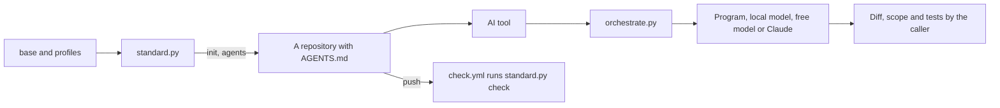

# How it works

This repository is the standard itself: rules as data, the program that applies them, and the tools around them. This file follows the rule it sets for every repository.

## From start to finish

The main use case is a repository that adopts the standard and stays inside it.

1. The owner runs `scripts/standard.py` with `init` and a profile name. It reads the shared rules in `base/base.yml` and the profile in `profiles/`, asks the setup questions, and writes `.standard.yml`, the folders, the files under `base/files/` and the generated `AGENTS.md` in the new repository.
2. An AI tool opens that repository and reads `AGENTS.md`. In Claude Code the hooks in `hooks/` also run: they ask before irreversible actions, scan for secrets and list the executors of the machine.
3. Work is routed. `scripts/orchestrate.py` reads `settings/orchestration.yml` and `settings/models.yml` and answers who may do a task: a program without AI, a local model, a free remote model or Claude. Cost and privacy are checked before anything is sent. The answer can be blocked.
4. Work is delegated and checked by the caller. A coding agent works in its own worktree. `orchestrate.py` then checks the diff, the allowed files, the protected files and the tests, and only a result that passes is committed on its own branch.
5. Every push and pull request of that repository calls `.github/workflows/check.yml` from here, which runs `scripts/standard.py` with `check`: structure, intent, generated files and content.
6. The owner changes the standard here, raises the version in `base/base.yml` and releases. Each repository picks the change up through its pinned version tag.



## Parts

- `base/base.yml`: rules and required files shared by every profile. `base/files/` holds the files every repository receives and `base/agents.md.tmpl` is the template of the generated `AGENTS.md`.
- `profiles/`: one folder per profile with its `profile.yml`: folders, fixed rules, techniques that need a reason and setup questions. `profiles/web/subprofiles.yml` describes the five web sub-profiles.
- `scripts/standard.py`: the engine. It creates, regenerates, checks and migrates repositories, and packages the skills.
- `scripts/orchestrate.py`: routing, delegation, bench, consent and the gate every model call passes.
- `scripts/bench_tasks.py`: the synthetic bench tasks and the code that grades them.
- `scripts/analyze.py`: the night run that tests the model candidates and writes the report.
- `scripts/verify.py` with `scripts/evidence.py`: the independent verifier and its report format. `scripts/adversarial.py` attacks the controls on purpose.
- `scripts/preserve.py`, `scripts/safe_patch.py` and `scripts/memory.py`: data protection, proven patches and local memory.
- `settings/`: policy as data. `settings/orchestration.yml` is the routing, privacy and cost policy, `settings/models.yml` the model candidates, `settings/mcp/catalog.yml` the MCP servers and `settings/opencode/` the OpenCode setup.
- `skills/`: the source of the skills. `agents/` and `hooks/` are published with them.
- `patterns/`: one card per design pattern. `radar/radar.yml`: every evaluated tool with its status.
- `prompts/`: text for AI tools that have no skills.
- `tests/`: unit tests of the scripts, with fake executors in `tests/fakes.py`.
- `docs/`: the standard explained in reading order.

## Where to start reading

Start with `README.md`, then `docs/000-philosophy.md`. For the code, open `scripts/standard.py` at `main` and follow the `check` command into `run_check`: it shows every rule the standard enforces in the order it runs. For routing, read `gate` and `route` in `scripts/orchestrate.py` next to `settings/orchestration.yml`.

## Run it and check it

```
pip install pyyaml
python scripts/standard.py selftest
python -m unittest discover -s tests
python scripts/verify.py --level standard
```

The selftest creates one repository per profile and checks it. The unit tests cover the scripts. `verify.py` runs both, the adversarial suite and the linters it finds, and writes a report. Add `--level deep --live` to also test the executors of the machine.

## Not covered

- The standard does not run a project's own build or deploy. It checks structure, intent and the pull request contract.
- Hooks and subagents run only in Claude Code. In OpenCode the checks are commands the agent runs.
- A worktree separates the files of a delegated agent. It is not an operating system sandbox: the agent can still reach the network and other folders the user can.
- The services listed under `services` in `settings/models.yml` have no adapter.
- Planning, deep review and visual direction have no bench class, so no free model can earn them yet.
